<picture>
  <source media="(prefers-color-scheme: dark)" srcset="./assets/banner-dark.svg" />
  
</picture>

  <a href="https://abdo77.com.ve"><b>abdo77.com.ve</b></a>&nbsp;&nbsp;·&nbsp;&nbsp;<a href="https://instagram.com/abdointernet">Instagram</a>&nbsp;&nbsp;·&nbsp;&nbsp;<a href="https://www.youtube.com/channel/UCx5ec4CDy-ntGXTedUvljag">YouTube</a>&nbsp;&nbsp;·&nbsp;&nbsp;<a href="mailto:info@abdo77.com.ve">info@abdo77.com.ve</a>

### Nosotros

- Internet para hogares y negocios en **Güigüe, Carabobo**, por **fibra óptica** y **radiofrecuencia**.
- Velocidad **simétrica**, internet **ilimitado** e **IPv6** público.
- Aquí vive el software con el que operamos la red y atendemos a nuestros clientes.

### Qué construimos

- **Panel administrativo** para la gestión del ISP: clientes, planes y red.
- **App de clientes** para web y Android.
- **Gestión de ONUs** y servicios de automatización de la red y reportes.
- **Bot de atención con IA (RAG)** para WhatsApp, Facebook e Instagram, integrado al CRM.

### Stack

<picture>
  <source media="(prefers-color-scheme: dark)" srcset="https://skillicons.dev/icons?i=ts%2Cbun%2Cangular%2Creact%2Cpy%2Cfastapi%2Cpostgres%2Cmongodb%2Credis%2Cdocker&perline=10&theme=dark" />
  
</picture>

También: Elysia · React Native · Expo · pgvector · RAG · LangChain
